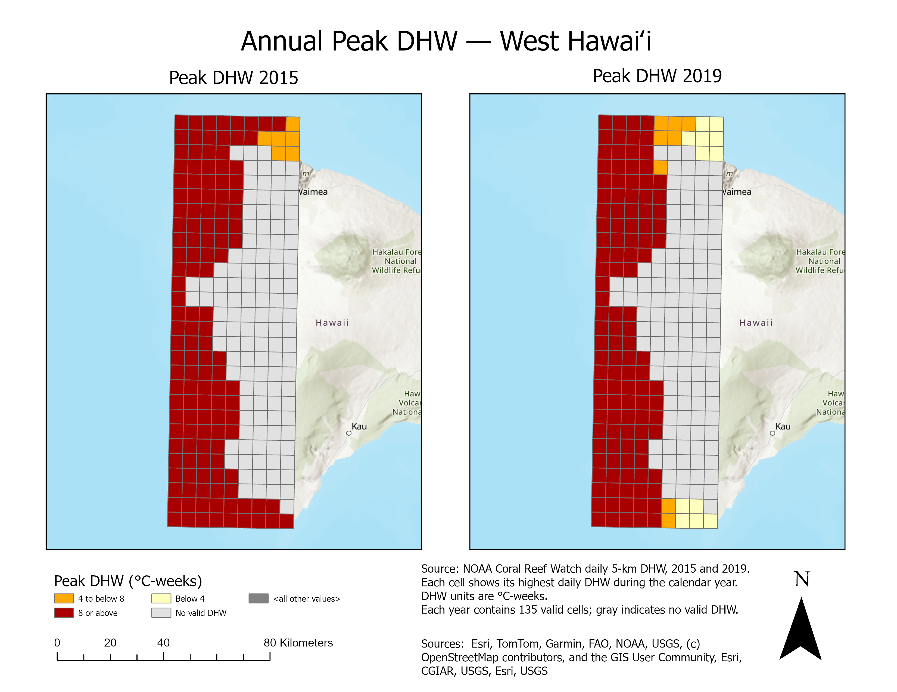

# West Hawaiʻi Heat Stress

An ASM54000 GIS term project by Drew Baker. I compare reef heat exposure in 2015 and 2019, check satellite temperatures against underwater loggers, and test seven-day sea-surface temperature forecasts.

**[Process log](Documentation/PROCESS_LOG.md)** · **[Python notebook](Analysis/Q3/Q3_SST_Forecasting.ipynb)** · **[GIS project download](https://github.com/drwbkr1/West-Hawaii-Heat-Stress-ASM540/releases/tag/v2026.10.16-final)**



## What I found

- **2015 had greater accumulated heat stress.** Among 135 paired water cells, median annual peak Degree Heating Weeks (DHW) was 11.64 in 2015 and 10.39 in 2019. Mapped reef and hardbottom area reaching DHW ≥8 declined from 4,731 to 3,612 hectares.
- **Satellite and underwater temperatures differed by site and season.** In the matched August–November observations, satellite–logger RMSD was lower in 2019 at all three sites.
- **Persistence beat the random forest overall.** Across 11,754 held-out forecasts in 2015–2025, seven-day SST MAE was 0.2228 °C for persistence and 0.2350 °C for the random forest. Performance varied by cell and year.

## Explore the project

| Resource | Contents |
| --- | --- |
| [Process log](Documentation/PROCESS_LOG.md) | Step-by-step GIS and forecasting methods, recorded processing dates, source download links, and reference results |
| [Word process log](GISProjectDrewBaker/Documentation/GISProcessLogDrewBaker.docx) | Course document version of the log |
| [Forecasting notebook](Analysis/Q3/Q3_SST_Forecasting.ipynb) | Executed Python analysis, chronological splits, baselines, random forest, evaluation, and figures |
| [Six-slide presentation](GISProjectDrewBaker/Documentation/GISPresentationDrewBaker.pptx) | Study approach, results, and future work |
| [Maps, charts, and animations](Documentation/Figures) | Q1 exposure maps, Q2 comparisons, and annual Q3 forecast performance |
| [Data sources](Data/README.md) | Download locations, coverage, attribution, and missing dates |

## Open the GIS project

Download **GISProjectDrewBaker.zip** from the [final GIS release](https://github.com/drwbkr1/West-Hawaii-Heat-Stress-ASM540/releases/tag/v2026.10.16-final), extract it, and open `GISProjectDrewBaker/WestHawaii_HeatStress.aprx` in ArcGIS Pro. The package contains the finished geodatabase, maps, layouts, process log, presentation, and selected result exports. Use this release ZIP to download the geodatabase.

See the [GIS folder guide](GISProjectDrewBaker/README.md) for map contents and dependencies. The earlier [reproduction archive](https://github.com/drwbkr1/West-Hawaii-Heat-Stress-ASM540/releases/tag/v2026.10.16) retains the original source and working data separately from this cleaned course package.

## Run the notebook

Clone or download this repository. With Python 3.12, create an environment and install the recorded dependencies:

```sh
python -m venv .venv
.venv/Scripts/python -m pip install -r requirements.txt
```

On macOS/Linux, use `.venv/bin/python` in the installation command. Open `Analysis/Q3/Q3_SST_Forecasting.ipynb` in VS Code or Jupyter, select the environment, and run all cells. The three-cell CSV archive is included. The final animation cells assemble the supplied ArcGIS map frames.

[Read the StoryMap](https://storymaps.arcgis.com/stories/7e6551719d15418a997e2517c2bc24cc).
